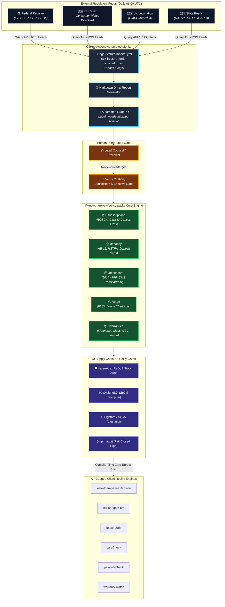
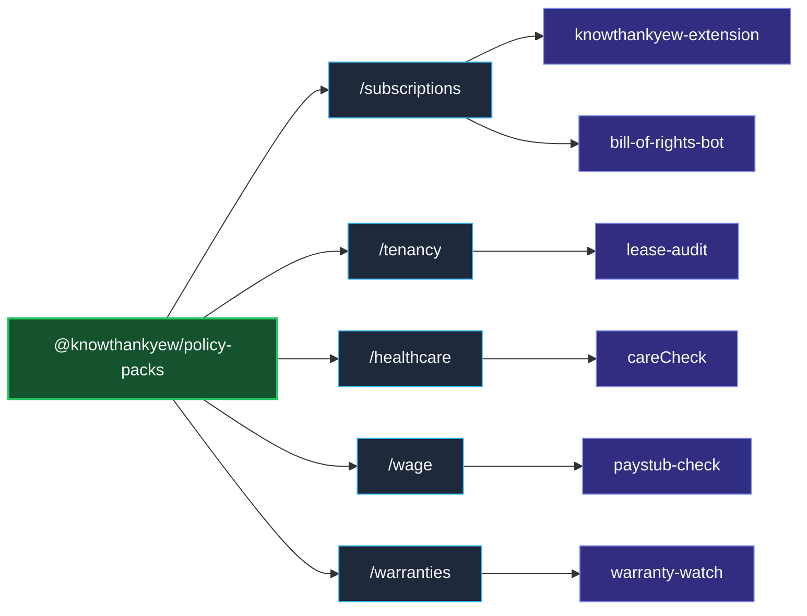

<!-- diagram-meta
  last-validated: 2026-10-26
  validated-commit: 2717e18
  covers: [src/**, schemas/**, scripts/**, .github/workflows/**]
  generated-by: manual
-->

# Architecture & Pipeline Specification: Policy Packs Engine

> Centralized, version-controlled statutory intelligence and regulatory policy engine for `knowthankyew` client reality engines.

---

## 1. Executive Summary

`@knowthankyew/policy-packs` serves as the statutory backbone of the `knowthankyew` portfolio. Rather than scattering legal regexes, statutory threshold tables, and citation anchors across individual repositories, `policy-packs` centralizes all legal logic into modular, domain-separated packages. Consuming client applications ingest this package as a strictly compile-time, zero-egress air-gapped dependency.

---

## 2. System Architecture & Upstream Pipeline

### A. Regulatory Crawler & Human-in-the-Loop PR Pipeline



### B. Consuming Domain Matrix



---

## 3. Core Architectural Invariants

| # | Invariant | Description & Enforcement |
|:--|:----------|:--------------------------|
| 1 | **Zero-Egress Air-Gap** | Consumed strictly as a compile-time dependency; zero runtime network callers exist in the package. |
| 2 | **Explicit Legal Grounding** | Every rule must provide `statuteRef`, `jurisdiction`, `effectiveDate`, `lastAudited`, and `officialSourceUrl`. |
| 3 | **ReDoS-Free Regexes** | 100% of patterns validated using `safe-regex` to eliminate exponential backtracking risks. |
| 4 | **Human-in-the-Loop Review** | Daily monitors generate draft PRs labeled `needs-attorney-review`; no autonomous mutation without human verification. |
| 5 | **Supply Chain Integrity** | CycloneDX SBOM (`bom.json`) + Sigstore / Cosign keyless attestation on every build. |

---

## 4. Directory Structure

```
policy-packs/
├── .github/workflows/
│   ├── ci.yml                     # Test, lint, build, ReDoS & SBOM generation
│   └── legal-statute-monitor.yml  # Daily 06:00 UTC crawler & draft PR generator
├── schemas/                       # Canonical JSON Schemas for statutory rules
├── scripts/
│   ├── audit-claims.mjs           # Enforces statutory grounding metadata presence
│   ├── check-statutory-updates.mjs# Multi-jurisdictional crawler script
│   └── generate-sbom.mjs          # CycloneDX SBOM generator
├── src/
│   ├── subscriptions/             # Auto-renewal, click-to-cancel & arbitration rules
│   ├── tenancy/                   # Security deposits, illegal waivers & habitability
│   ├── healthcare/                # 501(r) charity care & price transparency rules
│   ├── wage/                      # FLSA, overtime & state wage theft rules
│   └── warranties/                # Magnuson-Moss, UCC & lemon law rules
├── tests/                         # Vitest suites + ReDoS validation tests
├── package.json                   # Multi-subpath exports definition
└── vite.config.ts                 # Build configuration
```
